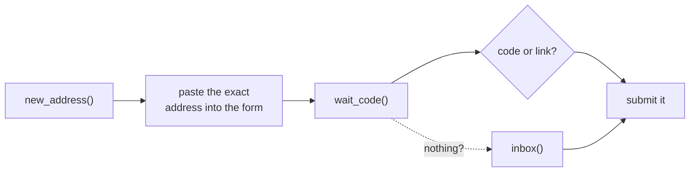

# gmail-dot

A local [MCP](https://modelcontextprotocol.io) server that turns one Gmail account
into unlimited signup identities using Gmail's dot trick — and hands an agent the
verification code or confirmation link that arrives.



Every `jane.doe@gmail.com`, `j.an.edoe@gmail.com` and
`janedoe+mm3fa1c9@gmail.com` lands in the same real inbox as `janedoe@gmail.com`. Gmail treats them
as one address; almost every website treats them as different people.

Three tools, no daemon, no port, no database. `mcp` is the only dependency.

## Install

Needs Python 3.11+ and a Gmail app password
([create one](https://myaccount.google.com/apppasswords) — 2FA must be on; the
16-character password is what this server uses, never your real password).

```bash
git clone https://github.com/dumbzombies/gmail-dot-mcp
cd gmail-dot-mcp
pip install -r requirements.txt          # or: uv pip install -r requirements.txt
python3 server.py --add you@gmail.com 'abcd efgh ijkl mnop'
```

`--add` logs into IMAP before writing anything, so a bad password fails loudly
and stores nothing:

```
added you@gmail.com (inbox 249 messages)
```

Check it any time:

```bash
python3 server.py --doctor      # login + inbox count + latency
python3 server.py --list        # accounts and alias counts
python3 server.py --self-test   # sends itself mail and extracts it end to end
```

## Register with your client

**omp / Claude Desktop / any `mcpServers` client**

```json
{
  "mcpServers": {
    "gmail-dot": {
      "command": "/usr/bin/python3",
      "args": ["/absolute/path/to/gmail-dot-mcp/server.py"]
    }
  }
}
```

**opencode**

```json
{
  "mcp": {
    "servers": {
      "gmail-dot": {
        "type": "local",
        "command": ["/usr/bin/python3", "/absolute/path/to/gmail-dot-mcp/server.py"],
        "timeout": { "execution": 300000 }
      }
    }
  }
}
```

Use an absolute path to `server.py`; the client spawns it with its own cwd.

## The flow

```
new_address()                     -> {"address": "j.ane.doe@gmail.com", "account": "...", "mode": "dots"}
<fill the signup form with that exact string>
wait_code()                       -> {"found": true, "code": "423979", "link": "", "subject": "...", ...}
```

`wait_code()` with no arguments uses the newest alias. Most sites send either a
code or a link; both are extracted, and a link-only mail (a bare "Confirm" button)
still counts as found.

| Tool | Argument | Returns |
|---|---|---|
| `new_address` | `label`, `mode` (`dots`\|`plus`) | fresh address + the account it maps to |
| `wait_code` | `address`, `digits`, `timeout` | code, link, subject, sender, received_at, preview |
| `inbox` | `address`, `limit` | recent mail for that alias with code/link already extracted |

Nothing arrives? `inbox()` shows what actually landed — subject, sender, and
extracted fields — which separates "the site never sent it" from "extraction
missed it".

## Behaviour worth knowing

- **Exact-string matching.** Gmail's `To:` header search ignores dots, so it
  matches every alias at once. This server fetches headers and re-filters on the
  literal recipient (`To` / `X-Original-To` / `Delivered-To`), dots included —
  `From` and `Subject` are not consulted, so a mail that merely *mentions* an
  alias never lands in that alias's inbox.
- **BCC still works.** When a form delivers the mail in the envelope only (no
  `To:` at all, or the account address in it), the topmost `Received:` header's
  `for <address>` clause is matched the same way — it is the one dot-exact trace
  a BCC delivery leaves, and the one Gmail's own search cannot see.
- **Links are qualified, not guessed.** A URL is returned only if it looks like a
  verification target (keyword in the URL, a `verify`/`confirm`-style anchor, or
  the sender's own domain). Tracking and unsubscribe URLs are vetoed outright, so
  a newsletter never produces a fake "found".
- **Watermarks.** `new_address` records the inbox's highest UID *before* returning,
  so only mail that arrives afterwards is matched. On a hit the watermark
  advances, so reusing one alias never replays the previous code.
- **Spam.** After 15 s of waiting, `[Gmail]/Spam` is scanned too (its UIDs are a
  separate space, so a date bound is used instead).
- **`mode`.** `dots` (default) inserts a random count of dots (1–8, tunable with
  `GMAIL_MCP_MAX_DOTS`) at random positions — for a normal-length local part that
  is 10⁶+ distinct strings, so the same alias practically never comes up twice.
  `plus` appends `+mm<random>`. Short local parts and a fully exhausted dot space
  fall back to `plus`; the returned `mode` is what was actually used.
- **Read-only.** Mail is fetched with `BODY.PEEK`, so nothing is ever marked read,
  moved, or deleted. The only write to your account is `--self-test`, which mails
  itself.
- **One write path.** Aliases are never reused across accounts and stay capped at
  500 entries, oldest dropped first.

## Files

```
~/.config/gmail-mcp/accounts.json   0600  [{"email": "...", "app_password": "..."}]
~/.config/gmail-mcp/state.json      0600  aliases + watermarks
```

Override the accounts path with `GMAIL_MCP_ACCOUNTS=/path/to/accounts.json` —
useful for keeping several identities apart. Nothing is read at import time, so
editing either file takes effect immediately; no restart.

## Troubleshooting

| Symptom | Cause |
|---|---|
| `gmail login failed … AUTHENTICATIONFAILED` | app password revoked or 2FA off — regenerate it |
| `no gmail accounts configured` | `--add` was never run, or `accounts.json` is unreadable |
| `no alias yet; call new_address() first` | `wait_code()` before any alias exists |
| `found: false` | the site never sent mail; check `inbox()` for a preview |
| site says the address is already used | that site strips dots — retry with `mode="plus"` |

## Limitations

Several accounts can be configured and are used round-robin, but each alias
belongs to exactly one real inbox. Google may rate-limit app-password logins
from an unfamiliar IP; `--doctor` shows the login latency if you suspect that.

A site that normalises dots before storing (some do) will treat every alias as the
base address. That is a property of the site, not of this server — use `plus` mode
for it.

The extraction heuristics live in `extract.py` and are plain functions; if a
particular sender's template defeats them, fix the scoring there rather than
patching the server.

## Tests

```bash
python3 tests/run_tests.py           # offline: fakes IMAP, ~2 s
python3 tests/run_tests.py --live    # real mailbox round trip (needs an account)
python3 tests/stdio_smoke.py         # speaks MCP over stdio to server.py
```

The live run creates a throwaway alias, BCCs itself through `smtp.gmail.com`, and
checks the envelope-only path, the replay guard, and the `inbox()` view; the alias
is deleted afterwards. `stdio_smoke.py` checks the wire protocol — tool list,
descriptions, JSON shapes, and that bad arguments come back as tool errors rather
than as a crashed server.

## License

MIT
